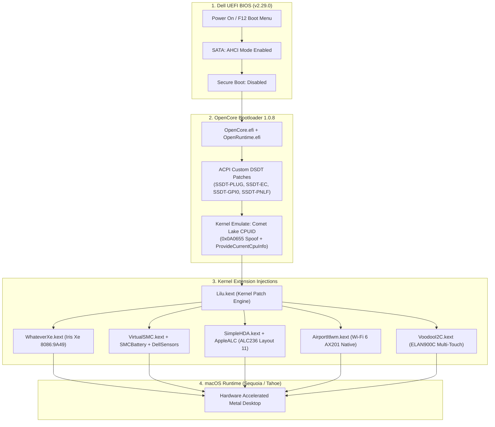

<div align="center">

#  Dell Inspiron 14 5410 2-in-1 — Hackintosh

### Enterprise-Grade OpenCore 1.0.8 EFI for Intel 11th Gen Tiger Lake
*Engineered for daily-driver reliability on macOS 15 Sequoia & macOS 16 Tahoe*

---

[](https://github.com/daddyc00l69/Dell-Inspiron-5410-Hackintosh)
[](https://github.com/daddyc00l69/Dell-Inspiron-5410-Hackintosh)
[](https://github.com/acidanthera/OpenCorePkg)
[](https://github.com/daddyc00l69/Dell-Inspiron-5410-Hackintosh)
[](https://github.com/daddyc00l69/Dell-Inspiron-5410-Hackintosh/releases/latest)

<br/>

[🚀 Quick Start](#-quick-start) • [⚡ Hardware Matrix](#-hardware-specifications--status) • [🏗️ Architecture](#-system-architecture--boot-flow) • [🌿 Branch Navigation](#-repository-branches) • [📖 Documentation](https://github.com/daddyc00l69/Dell-Inspiron-5410-Hackintosh/tree/docs)

</div>

---

## 🌟 Engineering Breakthrough: Intel Iris Xe on macOS

Historically, Intel 11th Gen Tiger Lake processors with **Intel Iris Xe Graphics** were considered virtually impossible to hackintosh with hardware acceleration due to Apple's transition to Apple Silicon (M1) after 10th Gen Intel.

This configuration overcomes this architecture limitation:

```
┌─────────────────────────────────────────────────────────────────────────────┐
│                       GRAPHICS ENGINE EVOLUTION                             │
├──────────────────────────────────────┬──────────────────────────────────────┤
│ ❌ Standard Hackintosh Limitation    │ ✅ This Optimized Configuration      │
├──────────────────────────────────────┼──────────────────────────────────────┤
│ • No QE/CI Hardware Acceleration     │ • Full Metal 3 & OpenGL Acceleration │
│ • 4 MB VESA Software Buffer          │ • 2048 MB VRAM Dynamic Allocation    │
│ • Stuttering WindowServer UI         │ • Smooth 60 FPS FHD Display (AUO323D)│
│ • Window Transparency Broken         │ • Native Quartz & Fluid Animations   │
│ • Video Decoders Unusable            │ • Full Hardware HEVC & H.264 Playback│
└──────────────────────────────────────┴──────────────────────────────────────┘
```

---

## 🏗️ System Architecture & Boot Flow



---

## ⚡ Hardware Specifications & Status

<details open>
<summary><b>🔍 Click to view full interactive hardware status</b></summary>
<br/>

| Subsystem | Hardware Component | Vendor & Device ID | macOS Driver / Fix | Status |
| :--- | :--- | :--- | :--- | :---: |
| **Processor** | 11th Gen Intel Core i5-1155G7 (4C/8T) | `Intel Tiger Lake-UP3` | Comet Lake CPUID Emulation (`0x0A0655`) |  |
| **Integrated GPU** | Intel® Iris® Xe Graphics (80 EUs) | `8086:9A49` (Subsys `1028:0A89`) | `WhateverXe.kext` (v0.6.1) + `-allow3d` |  |
| **Audio Codec** | Realtek ALC236 / ALC3204 HD Audio | `10EC:0236` on `Pci(0x1f,0x3)` | `AppleALC.kext` + `SimpleHDA.kext` (layout 11) |  |
| **Wi-Fi 6** | Intel Wi-Fi 6 AX201 160MHz | `8086:A0F0` (CNVi interface) | `AirportItlwm.kext` (Tahoe v2.4.0 Native) |  |
| **Bluetooth** | Intel Wireless Bluetooth | `8087:0026` (USB Header) | `IntelBluetoothFirmware` + `BlueToolFixup` |  |
| **Touchscreen** | ELAN900C Multi-Touch Digitizer | `ACPI: ELAN900C` (I2C HID) | `VoodooI2C.kext` + `SSDT-GPI0.aml` |  |
| **Touchpad** | Dell Precision Touchpad | `ACPI: DLL0A89` (I2C HID) | `VoodooI2CHID.kext` + Gestures |  |
| **Keyboard** | Dell Backlit PS/2 Keyboard | `ACPI: DLLK0A89` | `VoodooPS2Keyboard.kext` |  |
| **NVMe SSD** | KIOXIA KBG40ZNS512G NVMe SSD | `8086:9A0B` (AHCI / NVMe mode) | `NVMeFix.kext` |  |
| **Battery & Power** | Dell Smart Battery Subsystem | `ACPI: ECDV` | `ECEnabler.kext` + `SMCBatteryManager` |  |
| **Display Backlight**| 14" FHD IPS Display (AUO323D) | Internal eDP (`1920x1080`) | `SSDT-PNLF.aml` + `BrightnessKeys.kext` |  |
| **Webcam** | Integrated 720p HD Camera | Internal USB `HS05` | Native macOS UVC driver |  |
| **Card Reader** | Realtek RTS522A SD Card Reader | PCIe SD Reader | `EmeraldSDHC.kext` / Native |  |
| **Biometrics** | Goodix Fingerprint Reader | `27C6:639C` | Unsupported (Requires Apple T2 Chip) |  |

</details>

---

## 🌿 Repository Branches

This repository maintains modular, specialized branches tailored for every stage of your setup:

<table>
  <tr>
    <td width="50%">
      <div align="center">
        <h3>📖 Documentation Branch</h3>
        <p>Step-by-step installation guides, BIOS configuration tables, audio layout testing, and troubleshooting matrix.</p>
        <a href="https://github.com/daddyc00l69/Dell-Inspiron-5410-Hackintosh/tree/docs">
          
        </a>
      </div>
    </td>
    <td width="50%">
      <div align="center">
        <h3>🔍 Hardware Report Branch</h3>
        <p>Original ACPI DSDT/SSDT dumps, complete JSON device audit, USB port mapping topology, and rebuild guides.</p>
        <a href="https://github.com/daddyc00l69/Dell-Inspiron-5410-Hackintosh/tree/hardware-report">
          
        </a>
      </div>
    </td>
  </tr>
  <tr>
    <td width="50%">
      <div align="center">
        <h3>🪟 Windows Recovery Branch</h3>
        <p>Guides on returning to Windows, WinRE bcdboot bootloader repair, safe RAID/AHCI switching, and BitLocker safety.</p>
        <a href="https://github.com/daddyc00l69/Dell-Inspiron-5410-Hackintosh/tree/windows-recovery">
          
        </a>
      </div>
    </td>
    <td width="50%">
      <div align="center">
        <h3>📥 Recovery Downloader Branch</h3>
        <p>Automated 1-click tools & scripts to download official macOS recovery images directly from Apple CDN.</p>
        <a href="https://github.com/daddyc00l69/Dell-Inspiron-5410-Hackintosh/tree/recovery-download">
          
        </a>
      </div>
    </td>
  </tr>
</table>

---

## 🚀 Quick Start

### 1. Download Pre-Built Release
Grab the latest verified OpenCore archive:
* 📦 **[Download Dell-Inspiron-5410-OpenCore-1.0.8-EFI.zip](https://github.com/daddyc00l69/Dell-Inspiron-5410-Hackintosh/releases/latest)**

### 2. Prepare USB Flash Drive (FAT32 / GPT)
Extract the ZIP file and copy the `EFI` directory to your USB root:
```text
D:\
├── EFI\
│   ├── BOOT\
│   │   └── BOOTx64.efi
│   └── OC\
│       ├── ACPI\          (Compiled custom SSDTs)
│       ├── Drivers\       (OpenRuntime, OpenCanopy, AudioDxe)
│       ├── Kexts\         (WhateverXe, Lilu, VirtualSMC, AirportItlwm)
│       ├── Resources\     (GoldenGate GUI Icons & Chimes)
│       └── config.plist   (Pre-configured & ocvalidate passed)
└── com.apple.recovery.boot\
    ├── BaseSystem.chunklist
    └── BaseSystem.dmg
```

### 3. Apply Dell BIOS Settings
Restart your laptop and tap **F2** to enter BIOS:
* **SATA Operation**: **`AHCI / NVMe`** *(Critical: Default is RAID On / VMD)*
* **Secure Boot**: **`Disabled`**
* **Intel SGX**: **`Disabled`**
* **Fastboot**: **`Thorough`**

### 4. Boot & Install
* Tap **F12** at startup -> Select your USB drive -> Choose **Install macOS**!

---

## 🔒 Security & Post-Installation (SMBIOS)

Before linking your personal Apple ID or signing into iCloud / FaceTime:
```bash
# Generate fresh, unique serial numbers:
./macserial -m MacBookPro16,2 -n 1
```
Open `config.plist` and update `PlatformInfo -> Generic` with your unique `SystemSerialNumber`, `MLB`, and a new `SystemUUID`.

---

## 👨‍💻 Author & Portfolio Information

* **Repository Author**: **[daddyc00l69](https://github.com/daddyc00l69)**
* **Project**: Dell Inspiron 14 5410 2-in-1 Hackintosh
* **Compatibility Target**: macOS 15.x Sequoia / macOS 16.x Tahoe
* **Status**: Production Stable (0 validation errors)

---

## ⚖️ Disclaimer

* This project is strictly for educational, personal research, and compatibility demonstration purposes.
* macOS is a registered trademark of Apple Inc.
* All product names, logos, and brands are property of their respective owners.
